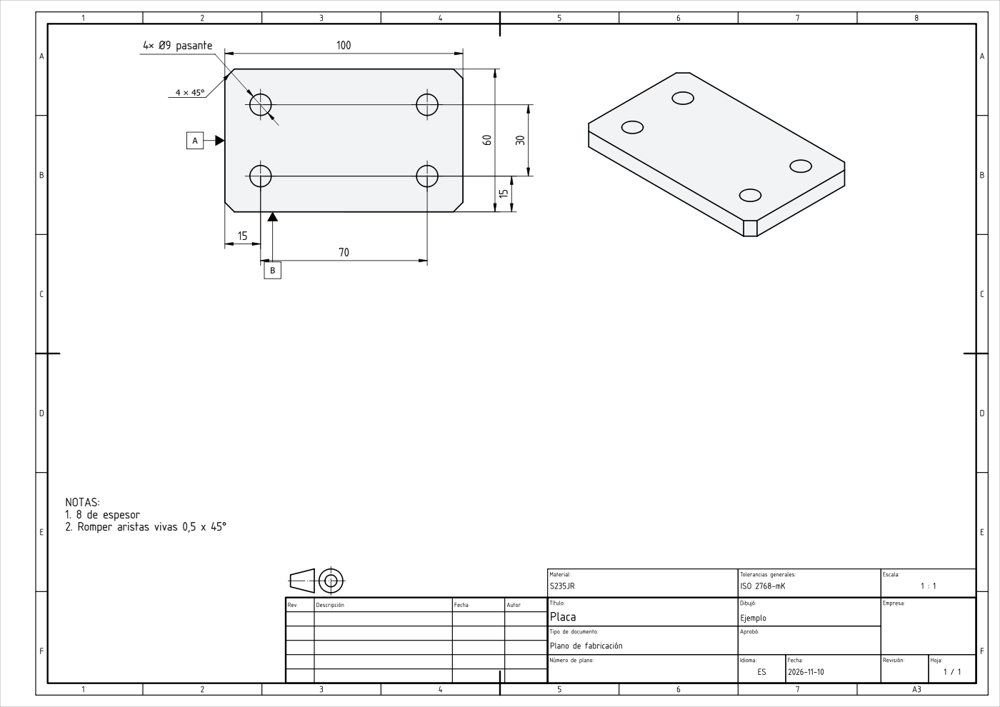

# Tu primera pieza

Una placa de acero de 100 x 60 x 8 mm con cuatro taladros. Desde el primer mensaje hasta el PDF.

Necesitas un proyecto abierto: ver [Instalar](install.md#tu-primer-proyecto). Las palabras del agente cambian de una sesión a otra. Los pasos y las medidas no.

## 1. Pídela

> `/cotaforge:plan` una placa de S235JR de 100 x 60 x 8 mm con cuatro taladros pasantes de 9 mm, a 15 mm de los bordes.

El agente hace unas preguntas cortas, como el proceso con que se fabrica. Responde en palabras simples. Anota tus respuestas.

También chaflana las esquinas de la placa a 45°, por defecto. Dilo si no lo quieres.

## 2. Lee el plan

Antes de modelar, el agente dice el plan en pocas líneas. Acéptalo o cámbialo.

## 3. Mira

Se abre la ventana de FreeCAD. La placa crece paso a paso: croquis, extrusión, taladros. Tras cada paso, el agente lee las medidas que devuelve FreeCAD.

Comprueba una a mano. Cada taladro Ø9 quita π × 4,5² × 8 ≈ 509 mm³, y cada esquina de 4 × 45° quita 4 × 4 / 2 × 8 = 64 mm³. Si las cifras del agente difieren, pregunta por qué.

Di "para" para interrumpir, o "deshaz el último paso".

## 4. Dibuja

> Haz el plano de taller en A3, vista superior e isométrica. Ubica el primer taladro desde el borde izquierdo y el borde frontal, y los otros desde él por distancia entre centros.

El agente entrega la pieza al **dibujante**, que se abre en su propia ventana. Pregunta lo que no sabe, como los bordes de referencia. El resultado:

*Una placa sintética, hecha con CotaForge y FreeCAD. Modo de revisión `own`: el agente respondió sus propios puntos de revisión.*

## 5. Revisa

El PDF no se escribe hasta que alguien distinto del dibujante haya mirado la hoja. El agente te pregunta una vez si la revisas tú o el agente **fabricante**. El fabricante lee solo el plano, nunca el modelo 3D, y lista lo que falta o no está claro. Si no respondes en 15 minutos, revisa él.

Cada punto se corrige o se responde. Las respuestas quedan en la hoja.

## 6. Exporta

Pide el PDF. La casilla "Aprobó" queda vacía hasta que le digas al agente que apruebe.

Siguiente: [cómo funciona](how-it-works.md).
