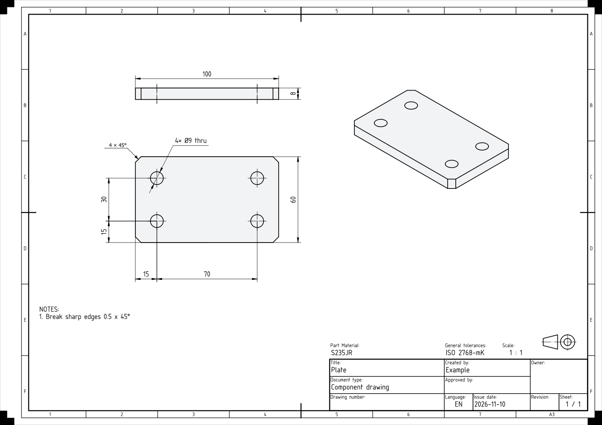

# Your first design

A small design from an idea: a plate to mount a motor on a frame. Your words and the agent's change from session to session. The flow does not.

You need an open project: see [Install](install.md#your-first-project).

## 1. State the need

> `/cotaforge:plan` I need a plate to mount a motor on a frame: about 100 x 60 mm, S235JR, four M8 bolts, the holes 15 mm from the edges.

## 2. Answer the questions

The first time, the agent asks how you want to work (see [three ways to start](how-it-works.md#three-ways-to-start)) and remembers it. It also asks the sector and the process that makes the part. Answer in plain words.

## 3. Steer the concept

With sketch first, the agent researches, looks for commercial parts such as the motor and the bolts, and proposes a quick sketch in FreeCAD. If you have 3D files of the commercial parts, hand them over.

Tell it what to change: "thicker", "holes closer to the edge". It saves a copy of the sketch you agree on, then pauses to ask what it assumed.

## 4. Watch the detail

The plate grows step by step: sketch, extrusion, holes, corner chamfers. Each step returns the measures FreeCAD gives.

Check one by hand. Each Ø9 hole removes π × 4.5² × 8 ≈ 509 mm³, and each 4 × 45° corner removes 4 × 4 / 2 × 8 = 64 mm³. Say "stop" to interrupt, or "undo the last step".

## 5. Draw

> Make the shop drawing on A3 with front view, top view and isometric. Locate the first hole from the left edge and the front edge, and the others from it by centre distance.

The **drafter** opens in its own window and asks what it does not know, such as which edges the positions are counted from.

*A synthetic plate, made with CotaForge and FreeCAD. Review mode `own`: the agent answered its own review points.*

## 6. Review

The PDF is not written until someone other than the drafter has looked at the sheet. The agent asks whether you review it or the **fabricator** agent does. The fabricator reads only the drawing, never the 3D model, and lists what is missing or unclear. If you do not answer in 15 minutes, it reviews. Every point is fixed or answered.

## 7. Review before production

Ask for the PDF. The "Approved by" box stays empty until you tell the agent to approve. Read the sheet yourself: as with any AI work, review it before production.

Next: [how it works](how-it-works.md).
